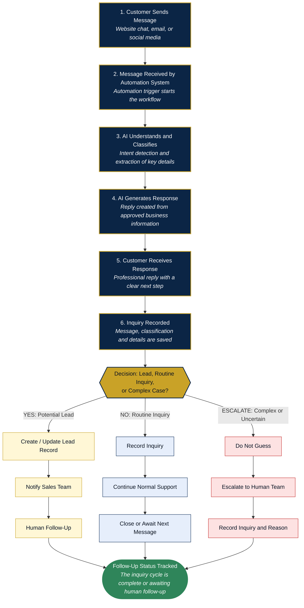
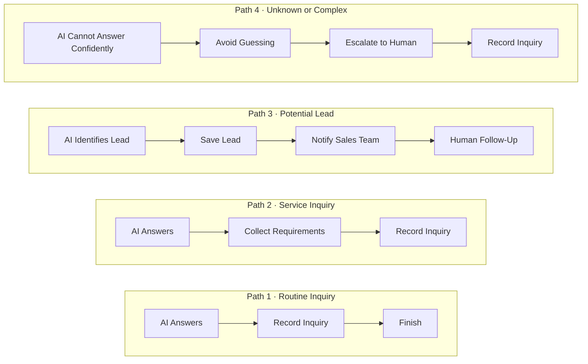
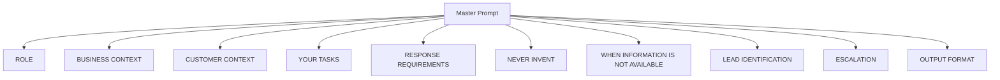
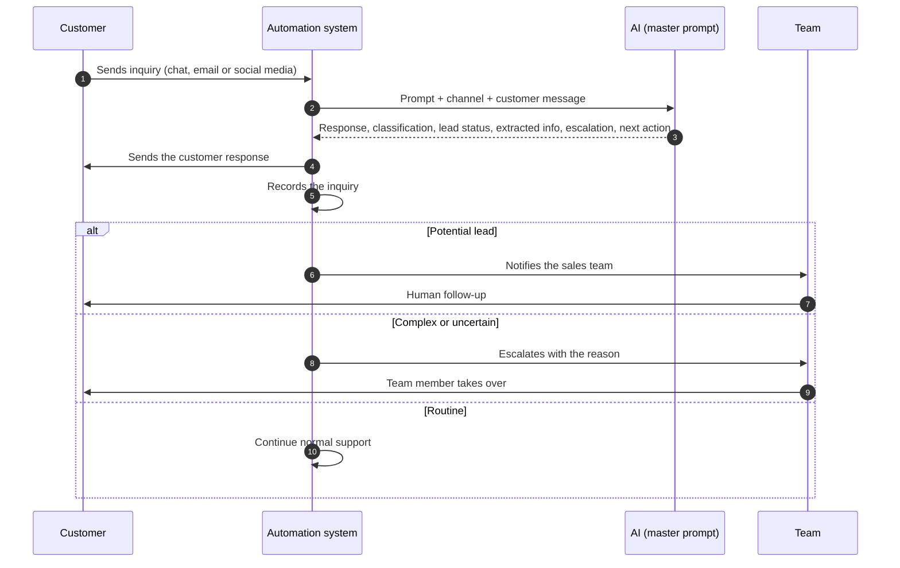
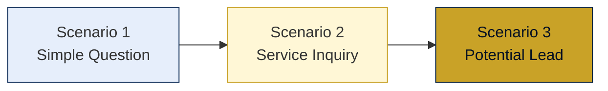
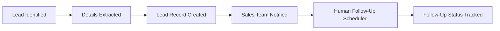
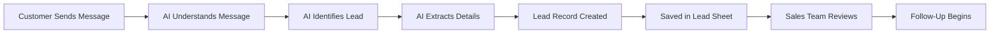
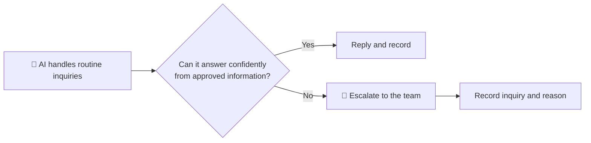
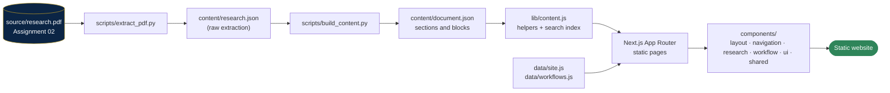

<!-- ============================ HEADER ============================ -->
<div align="center">


<a href="https://github.com/YOUR_USERNAME/ai-customer-inquiry-automation">
  
</a>

<br/>


-c9a227?style=flat-square)


<h3>
  <a href="#-live-demo">Live Demo</a> •
  <a href="#-getting-started">Getting Started</a> •
  <a href="#-the-workflow">Workflow</a> •
  <a href="#-the-master-prompt">Prompt</a> •
  <a href="#-testing-scenarios">Testing</a> •
  <a href="#-deployment">Deploy</a>
</h3>

<em>Innovating Digital Solutions | Empowering Digital Futures</em>

</div>

---

## 📑 Table of Contents

- [Overview](#-overview)
- [Live Demo](#https://customer-inq-automation-workflow.vercel.app/)
- [Project at a Glance](#-project-at-a-glance)
- [Important Notes on Scope](#-important-notes-on-scope)
- [The Sample Business](#-the-sample-business-star-developer)
- [The Workflow](#-the-workflow)
- [The Master Prompt](#-the-master-prompt)
- [Customer Questions and AI Responses](#-customer-questions-and-ai-responses)
- [Testing Scenarios](#-testing-scenarios)
- [Bonus Automation: Lead Recording](#-bonus-automation-lead-recording)
- [Human Oversight and Escalation](#-human-oversight-and-escalation)
- [Business Benefits](#-business-benefits)
- [Website Features](#-website-features)
- [Pages and Routes](#-pages-and-routes)
- [Architecture](#-architecture)
- [Technology Stack](#-technology-stack)
- [Getting Started](#-getting-started)
- [Available Scripts](#-available-scripts)
- [Project Structure](#-project-structure)
- [Content Management](#-content-management)
- [Design System](#-design-system)
- [Accessibility](#-accessibility)
- [Performance and SEO](#-performance-and-seo)
- [Responsive Behaviour](#-responsive-behaviour)
- [Deployment](#-deployment)
- [Environment Variables](#-environment-variables)
- [Troubleshooting](#-troubleshooting)
- [FAQ](#-faq)
- [Related Projects](#-related-projects)
- [Roadmap](#-roadmap)
- [About the Author](#-about-the-author)
- [Acknowledgements](#-acknowledgements)

---

## 🌐 Overview

**AI Customer Inquiry Automation Workflow** is a documentation web application built from **Practical Task 02** of the **AI Automation Internship at Zayan Soft Tech**.

The task takes a simple, common business problem, customers asking the same questions again and again, and turns it into a working design:

1. a **reusable master AI prompt**,
2. **five customer questions** answered with that prompt,
3. a clear **nine-step automation workflow** with a visual diagram,
4. **three testing scenarios**,
5. one **bonus automation** that records qualified leads, and
6. rules for **human oversight and escalation**.

The business used for the exercise is **Star Developer**, a sample IT and digital services company.

The website presents the complete document as a case-study documentation platform:

> Source document → structured content → searchable, responsive documentation with diagrams, prompt block and chat-style examples.

**Good for:** internship submission, portfolio presentation, mentor and recruiter review, and sharing on LinkedIn or WhatsApp.

---

## 🚀 Live Demo

| | |
|---|---|
| **Website** | https://customer-inq-automation-workflow.vercel.app/ |
| **Repository** | https://github.com/YasirAwan4831/ai-customer-inquiry-automation-workflow |
| **Previous project (Assignment 01)** | https://ai-automation-research.vercel.app/ |

> Replace the placeholders after you deploy.


---

## 📊 Project at a Glance

| Item | Detail |
|---|---|
| Task | Practical Task 02: Build Your First AI Customer Inquiry Automation Workflow |
Candidate | [Muhammad Yasir](https://yasirawaninfo.vercel.app/) |
| Program | AI Automation Internship |
| Organization | Zayan Soft Tech |
| Sample business | Star Developer (sample business for this exercise) |
| Document sections | 19 |
| Customer questions | 5 |
| Testing scenarios | 3 |
| Automation workflow | 9 steps |
| Logical paths | 4 (routine, service, potential lead, complex) |
| Bonus automation | Lead recording (concept) |
| Human escalation cases | 8 |
| Business benefits | 8 |
| Key takeaways | 10 |

---

## ⚠️ Important Notes on Scope

> [!IMPORTANT]
> This project keeps the claims of the source document exactly as written.

| This project **is** | This project **is not** |
|---|---|
| A reusable master AI prompt | A live, deployed automation system |
| Sample responses to five customer questions | Real customer conversations or customer data |
| A workflow design with a visual diagram | An existing integration with any tool or platform |
| Three testing scenarios | A source of accuracy, speed or time-saving statistics |
| A lead-recording **concept** | An actual Google Sheets integration |

- **Star Developer is a sample business.** The site makes no claims about the real operations, staff, customers, pricing or systems of any company.
- **Prices, timelines, guarantees, policies and contact details are never invented.** Where they are requested, the designed AI says that confirmation from the team is required.
- **No performance figures are claimed.** This is a design exercise, not a measured deployment.
- The customer name and email address in Testing Scenario 3 are **fictional sample test data**.

---

## 🏢 The Sample Business: Star Developer

| Field | Value |
|---|---|
| Business name | Star Developer |
| Business type | IT company / digital services company |
| Main services | Website Development, Web Application Development, Mobile Application Development, AI Solutions, AI Automation, Digital Marketing, Graphic Design, Custom Software Solutions, IT Solutions |
| Target customers | Businesses, startups, organizations and individuals who need digital products, software, websites, applications, automation or other technology-related services |
| Business problem | Customers often ask similar questions repeatedly. Answering each one manually uses employee time and can delay responses to potential customers |

### What the AI may say, and what needs a person

| The AI may use | Requires confirmation from the team |
|---|---|
| Business name and type | Exact prices, quotations and discounts |
| The list of main services | Delivery times and project deadlines |
| General, non-technical descriptions of services | Guarantees and company policies |
| Description of typical target customers | Contact details, addresses and availability |
| General guidance on what details help the team | Technical feasibility of specific or unusual requests |

---

## 🔄 The Workflow

### The core model


| Stage | Meaning | In this project |
|---|---|---|
| Receive | The inquiry arrives and starts the automation | A customer message from chat, email or social media triggers the workflow |
| Understand | The system works out what the customer wants | AI classifies the inquiry, detects intent and extracts key details |
| Generate | A suitable reply is prepared | AI writes a response using only approved business information |
| Respond | The customer receives the reply | A professional message with a clear next step is sent |
| Record | The inquiry is stored for the business | The message, classification and lead status are saved and the next action is triggered |

### The full workflow diagram



> Steps 3 and 4 of the nine-step table (classification and extraction) are combined into the diagram boxes for readability. This is a designed workflow and is not a deployed system.

### The nine-step workflow

| Step | What happens | Handled by | Output |
|---|---|---|---|
| 1. Customer Sends Message | A customer submits an inquiry through website chat, email or social media | Customer | Customer message |
| 2. Message Received | The automation trigger detects the new message and starts the workflow | Automation system | Message passed to the AI |
| 3. AI Classifies the Inquiry | The AI detects the intent and classifies the inquiry | AI | Inquiry classification |
| 4. AI Extracts Information | The AI picks out name, contact information, service of interest and requirement summary | AI | Extracted details |
| 5. AI Generates a Response | The AI writes a reply based on the master prompt and approved information | AI | Draft customer response |
| 6. Customer Receives the Response | The reply is sent through the same channel the customer used | Automation system | Delivered reply |
| 7. Inquiry Is Recorded | The message, classification, details and reply are saved in a structured record | Automation system | Inquiry record |
| 8. Inquiry Is Categorized | The inquiry is marked Potential Lead, Possible Lead or Not a Lead, and checked for escalation | AI and rules | Lead status |
| 9. Next Action Is Triggered | The correct next step is taken: finish, ask for details, save a lead and notify sales, or escalate | Automation system and team | Action completed |

### Where the workflow makes decisions

- **Classification:** the AI decides what type of inquiry has arrived.
- **Lead qualification:** the AI checks for project intent or shared contact details.
- **Escalation:** complex, sensitive or uncertain cases go to a human instead of being guessed.

### The four logical paths



| Path | When it applies | Example | Human involvement |
|---|---|---|---|
| 1. Routine | The question can be fully answered from approved information | Which services does the company offer? | None, unless the customer continues |
| 2. Service | The customer asks about a service and the team needs more details | Can you build a booking website? | Review requirements later |
| 3. Potential lead | The customer shows project intent or asks to be contacted | I need an e-commerce website. Please contact me. | Sales team follows up personally |
| 4. Unknown or complex | The AI is unsure, or the topic is sensitive or technical | A complaint, a contract question, an unclear request | A team member takes over |

> **Core rule:** when the AI is not confident, it must not guess. A short, honest reply followed by escalation is always better than an invented answer.

---

## 🧾 The Master Prompt

The master prompt is the core of the solution: one reusable instruction that tells the AI who it is, what it knows, what it must do with each message and what it must never invent.

### How to use it

1. Copy the prompt from the website (`/docs/6-master-ai-response-prompt`) using the **Copy prompt** button.
2. Replace `{{CHANNEL}}` with the source of the message, for example website chat.
3. Replace `{{CUSTOMER_MESSAGE}}` with the customer's message.
4. Send the completed prompt to the AI model.
5. Send the customer response to the customer. Use the other fields for recording and the next action.

### Prompt structure



| Component | Purpose |
|---|---|
| Role | Sets the voice and responsibility of the AI as a customer support representative |
| Business context | Gives the AI the approved facts about Star Developer |
| Customer context | Provides the customer message and channel |
| Tasks | Guides intent detection, response generation, lead checking and escalation |
| Response requirements | Controls tone, length and clarity |
| Never invent | Prevents made-up prices, guarantees, timelines, policies and contact details |
| Unavailable information | Teaches the AI to be honest and hand off to the team instead of guessing |
| Lead identification | Allows potential customers to be recognized and recorded |
| Escalation | Sends complex, sensitive or uncertain cases to a human |
| Output format | Produces structured fields the automation can use |

### Structured output

Every reply returns exactly these fields:

```text
CUSTOMER RESPONSE:        the reply to send to the customer
INQUIRY CLASSIFICATION:   General Inquiry | Service Inquiry | Pricing Inquiry |
                          Process/Timeline Inquiry | Consultation Request |
                          Potential Lead | Complaint/Complex
LEAD STATUS:              Potential Lead | Possible Lead | Not a Lead
EXTRACTED INFORMATION:    name, contact details, service of interest,
                          requirement summary ("Not provided" if missing)
ESCALATE TO HUMAN:        Yes | No, with a short reason
SUGGESTED NEXT ACTION:    one clear action for the automation
```

> The full prompt text is shown on the website exactly as written in the source document.

---

## 💬 Customer Questions and AI Responses

The five questions represent five different types of inquiry, so the prompt is tested across a realistic range.

| # | Customer question | Inquiry type | Classification | Lead status |
|---|---|---|---|---|
| 1 | "Hello, I run a small clothing brand. What services do you offer? I need help with both a website and online marketing." | General service inquiry | General Inquiry | Possible Lead |
| 2 | "Roughly how much would it cost to build a mobile app for my restaurant?" | Pricing inquiry | Pricing Inquiry | Potential Lead |
| 3 | "Can you build a custom website where my customers can book appointments and pay online?" | Development / service inquiry | Service Inquiry | Potential Lead |
| 4 | "How long does it usually take to build a business website, and how do I get started?" | Process and timeline inquiry | Process/Timeline Inquiry | Possible Lead |
| 5 | "We are a startup planning an AI chatbot for our customer support. Could someone from your team contact me to discuss it?" | Potential customer / lead | Potential Lead | Potential Lead (high intent) |

On the website each question is shown as a **chat-style card**: the customer message, the AI response, then the classification, lead status, extracted information and suggested next action.

### What a response looks like



---

## 🧪 Testing Scenarios

Three tests show how the same prompt behaves as the customer's intent becomes clearer.



| Scenario | Customer intent | AI response type | Next action | Lead status |
|---|---|---|---|---|
| 1. Simple question | Find out whether a consultation is possible | Friendly answer, no unconfirmed details, request for contact and project idea | Record inquiry, collect details, team confirms consultation | Possible Lead |
| 2. Service inquiry | Learn the cost of an e-commerce website | No price given, explains cost factors, asks for project details | Record, collect requirements, route to sales for quotation | Potential Lead |
| 3. Potential lead | Have the team contact them about an e-commerce website | Confirms request, notes contact method, invites helpful details | Create lead, notify sales, schedule human follow-up | Potential Lead (high intent) |

- **Scenario 1:** "Hi, do you offer consultations for new projects?"
- **Scenario 2:** "What is the cost of developing an e-commerce website for my online shop?" (proves the AI does not invent a price, a price range or a discount)
- **Scenario 3:** a customer with clear intent who shares fictional sample contact details

### Testing observation

In all three scenarios the AI stayed within the approved business information, did not invent prices, timelines or policies, and always ended with a clear next step. The tests show the designed behaviour of the prompt. They do not provide performance statistics.

### Lead handling steps (Scenario 3)



---

## 📋 Bonus Automation: Lead Recording

> [!NOTE]
> This is a **designed automation concept**. No actual Google Sheets integration has been deployed.

Qualified leads are saved into a structured lead record, such as a Google Sheets lead sheet, so the sales team can review and follow up.



### Information recorded

| Field | Description | Filled by |
|---|---|---|
| Date/Time | When the inquiry was received or the record created | Automation system |
| Customer Name | The name the customer shared, if any | AI extraction |
| Contact Information | Email or phone, and preferred contact method | AI extraction |
| Channel | Website chat, email or social media | Automation system |
| Inquiry | The customer's original message | Automation system |
| Service Interested In | For example Website Development or AI Automation | AI classification |
| Requirement Summary | A short summary of what the customer needs | AI summary |
| Lead Status | Potential Lead, Possible Lead or Not a Lead | AI and rules |
| Follow-Up Status | Pending, In Progress or Completed | Sales team |
| Notes | Missing details or remarks for the sales team | AI and sales team |

### When a record is created

| Lead status | When it applies | Action |
|---|---|---|
| Potential Lead | Clear project need or request for contact, with contact details available | Create the record, notify the sales team, schedule human follow-up |
| Possible Lead | Some interest, but the need or contact details are unclear | Create or update the record, ask for missing details, review again on reply |
| Not a Lead | General question with no project intent | Record the inquiry only and continue normal support |

### If important information is missing

- The AI writes **"Not provided"** in missing fields and never guesses or invents values.
- The customer is politely asked for the missing details, especially a name and a contact method.
- The lead is saved as "Possible Lead" or "Contact details pending" so it is not lost.
- When the customer replies, the existing record is **updated**, not duplicated.
- If no contact method is ever provided, the record stays visible to the team, who decide the next step.

---

## 🧑‍🤝‍🧑 Human Oversight and Escalation

AI handles routine inquiries but does not make every decision. **AI supports employees; it does not replace human judgment.**



| Situation | Why human judgment is needed | Automation behaviour |
|---|---|---|
| Complex project requirements | Technical details need expert review | Collect the details and escalate to the team |
| Exact pricing or quotations | Prices depend on a full evaluation | Explain that a quotation needs evaluation, route to sales |
| Contract-related questions | Contracts carry legal and financial responsibility | Do not answer, escalate to the responsible person |
| Complaints | Customers need empathy and a real solution | Acknowledge politely, escalate and record |
| Technical issues in existing projects | Diagnosis requires the technical team | Collect the issue description and escalate |
| Sensitive customer situations | Personal or delicate matters need careful handling | Avoid automated advice, hand over to a person |
| Low-confidence AI responses | The AI may misunderstand unclear messages | Do not guess, escalate with the reason |
| High-value leads | Important opportunities deserve personal attention | Notify the sales team promptly for human follow-up |

---

## 💼 Business Benefits

No performance figures are claimed, because this is a design exercise and not a measured deployment.

| Benefit | How it helps | Example |
|---|---|---|
| Time saving | Reduces repetitive manual replies | Common questions about services receive an automatic reply |
| Faster customer support | Customers can receive a response more quickly | A visitor asking a question at night receives a prompt answer |
| Lead management | Potential customers are identified and recorded | A customer asking for contact becomes a lead record |
| Better organization | Inquiries are stored in a structured way | Every inquiry has a classification, lead status and next action |
| Employee productivity | Employees spend less time on repetitive questions | Staff focus on project discussions and quotations |
| Follow-up | Potential leads are routed for human follow-up | The sales team is notified when a high-intent lead arrives |
| Reduced manual errors | A standardized prompt keeps responses consistent | The same approved information is used in every reply |
| Scalability | The workflow can handle more inquiries than a purely manual process | A larger number of messages can be processed in the same way |

---

## ✨ Website Features

### 📖 Documentation experience
- Layout: **sidebar | content | "On this page" contents**
- Active-section highlighting, **previous / next** links and **breadcrumbs**
- **Reading progress bar**
- **Copy-link** button on every subsection
- Section numbering that matches the source document

### 🔎 Search
- Client-side search, no external API
- Open with **`/`** or **`Ctrl / Cmd + K`**
- Results show the section, the matching subsection and a highlighted snippet
- Searches only the Assignment 02 content

### 🎨 Interface
- Sticky navbar with mobile hamburger menu
- **Light and dark mode**, remembered between visits
- Tables become **cards on mobile**
- Callout boxes for notes, limits and scope statements

### 🧩 Purpose-built components
- **Prompt block** with monospace text and a one-click **Copy prompt** button
- **Chat-style question and response cards**
- **Workflow diagram** with a decision node and three colour-coded branches
- **Flow strips** for short step sequences
- Responsive tables with keyboard-focusable scroll regions

### 🎬 Subtle animation
- Staggered hero entrance and a typing line in the hero
- Workflow nodes fade in step by step
- All animation is switched off when the visitor prefers reduced motion

---

## 🧭 Pages and Routes

| Route | What it shows |
|---|---|
| `/` | Hero, project at a glance, scope note, core workflow, Star Developer profile, workflow diagram, benefits |
| `/docs` | Index of all 19 sections |
| `/docs/[slug]` | One full section, for example `/docs/6-master-ai-response-prompt` |
| `/responses` | The five customer questions with AI responses and the summary table |
| `/workflow` | Workflow diagram, nine-step table and the four logical paths |
| `/testing` | Testing scenarios 1 to 3 and the results summary |
| `/about` | Project information, author, conclusion and key takeaways |
| `/search-index.json` | Static search index used by the search dialog |

### Documentation sections

| # | Section | # | Section |
|---|---|---|---|
| 1 | Business Introduction | 11 | Testing Scenario 2: Service Inquiry |
| 2 | Business Problem | 12 | Testing Scenario 3: Potential Lead |
| 3 | Selected Business Services | 13 | Testing Results Summary |
| 4 | Customer Inquiry Automation Objective | 14 | Bonus Automation: Lead Recording |
| 5 | Five Customer Questions | 15 | Human Oversight and Escalation |
| 6 | Master AI Response Prompt | 16 | Business Benefits |
| 7 | AI-Generated Responses | 17 | Practical Automation Logic |
| 8 | Automation Workflow | 18 | Conclusion |
| 9 | Workflow Diagram | 19 | Key Takeaways |
| 10 | Testing Scenario 1: Simple Question | | |

---

## 🏗 Architecture



Content is kept separate from the interface: the site renders **blocks** (`p`, `li`, `table`, `keyvalue`, `callout`, `prompt`, `qa`, `flow`, `workflow`, `numbered`) from one JSON file, so the text can change without touching components.

---

## 🛠 Technology Stack

| Layer | Technology |
|---|---|
| Framework | [Next.js 14](https://nextjs.org/) (App Router, static generation) |
| UI library | [React 18](https://react.dev/) |
| Styling | [Tailwind CSS 3](https://tailwindcss.com/) with CSS keyframe animations |
| Icons | [Lucide React](https://lucide.dev/) |
| Diagrams | Native React components (website) and Mermaid (this README) |
| Content | Structured JSON generated from the source PDF |
| Content tools | Python 3, `pdfplumber`, Pillow, `pdftotext` (only to regenerate content) |

---

## ⚡ Getting Started

### Prerequisites
- **Node.js 18.17 or newer**
- **npm**

### Install and run

```bash
# 1. Open the project folder
cd ai-customer-inquiry-automation

# 2. Install dependencies
npm install

# 3. Start the development server
npm run dev
```

Open **http://localhost:3000**.

### Production build

```bash
npm run build
npm start
```

---

## 📜 Available Scripts

| Command | Description |
|---|---|
| `npm run dev` | Development server with hot reload |
| `npm run build` | Optimized production build |
| `npm start` | Serve the production build |
| `npm run lint` | Run ESLint |
| `npm run extract` | Rebuild `content/` from `source/research.pdf` (needs Python tools) |

---

## 🗂 Project Structure

```text
ai-customer-inquiry-automation/
├── app/
│   ├── layout.js                   # Root layout, metadata, theme script
│   ├── page.js                     # Home
│   ├── docs/
│   │   ├── layout.js               # Sidebar + reading progress
│   │   ├── page.js                 # Section index
│   │   └── [slug]/page.js          # One documentation section
│   ├── responses/page.js           # Five questions and AI responses
│   ├── workflow/page.js            # Diagram, nine steps, four paths
│   ├── testing/page.js             # Three testing scenarios
│   ├── about/page.js               # Project info, author, conclusion
│   └── search-index.json/route.js  # Static search index
│
├── components/
│   ├── layout/                     # Footer
│   ├── navigation/                 # Navbar, Search, ResearchSidebar,
│   │                               # TableOfContents, ReadingProgress
│   ├── research/                   # Blocks, QACard, FlowStrip, ResponsiveTable
│   ├── workflow/                   # WorkflowDiagram
│   ├── ui/                         # PromptBlock, ThemeToggle, CopyLink,
│   │                               # TypingLine, Logo
│   └── shared/                     # Breadcrumbs, PrevNext
│
├── content/
│   ├── document.json               # Content rendered by the site
│   └── research.json               # Raw extraction (intermediate)
│
├── data/
│   ├── site.js                     # Titles, navigation, footer and social links
│   └── workflows.js                # Workflow diagram data
│
├── lib/content.js                  # Content helpers and search index
├── scripts/                        # extract_pdf.py, build_content.py
├── source/research.pdf             # Assignment 02 source document
├── public/                         # logo/ and images/
├── styles/globals.css              # Tailwind layers, animations
├── tailwind.config.js
├── next.config.mjs
└── package.json
```

---

## 📝 Content Management

All site text comes from **`content/document.json`**, an array of sections that each hold a list of `blocks`.

| Block type | Used for |
|---|---|
| `h2` | Numbered subsection heading (feeds contents list and search) |
| `h3` | Minor heading |
| `p` / `li` | Paragraph / bullet item |
| `table` | Responsive table (first row is the header) |
| `keyvalue` | Two-column fact box |
| `callout` | Highlighted note (scope, limits, observations) |
| `prompt` | The master prompt in the copyable code block |
| `qa` | Customer message and AI response card with its fields |
| `flow` | Short step sequence |
| `workflow` | The full workflow diagram |
| `numbered` | Numbered list (key takeaways) |

**Change wording:** edit `content/document.json` and save.
**Change the diagram:** edit `data/workflows.js`.
**Change footer or social links:** edit `data/site.js`.

**Regenerate everything from a revised PDF:**

```bash
pip install pdfplumber pillow        # plus poppler-utils for pdftotext
# replace source/research.pdf, then:
npm run extract
```

> [!IMPORTANT]
> Review the regenerated content. Table layouts are reconstructed from the PDF and may need small corrections.

---

## 🎨 Design System

| Token | Value | Use |
|---|---|---|
| Navy 950 / 900 / 800 | `#041022` / `#071a33` / `#0b2545` | Backgrounds, headings, footer |
| Gold 500 | `#c9a227` | Accents, progress bar, active markers |
| Slate | Tailwind slate scale | Body text and borders |
| Serif (Charter / Palatino / Georgia) | System fonts | Long-form reading text |
| Sans-serif (system UI) | System fonts | Navigation, tables, labels |

The navy and gold palette follows the cover of the source document. No web fonts are downloaded, so text renders immediately.

### Workflow colour coding

| Branch | Colour | Meaning |
|---|---|---|
| Trunk steps | Navy | Every inquiry goes through these |
| Lead path | Gold | Potential customer, sales follow-up |
| Routine path | Blue-grey | Answered, recorded, finished |
| Escalation path | Red | Do not guess, a person takes over |

Each branch also has an icon and a text label, so meaning never depends on colour alone.

---

## ♿ Accessibility

- Semantic HTML and a proper heading hierarchy
- **Skip to content** link
- Full keyboard navigation with visible focus outlines
- ARIA labels on icon buttons, navigation regions, the search dialog and the progress bar
- Workflow steps are real ordered lists with step numbers announced to screen readers
- Scrollable tables and the prompt block are keyboard focusable
- Respects `prefers-reduced-motion`
- Alt text on logos and images

---

## 🚄 Performance and SEO

- Every page is **pre-rendered** at build time
- Server Components by default, client code only for search, theme, navigation, progress, copy buttons and the typing line
- `next/image` for logos and photos
- No external fonts, analytics or runtime APIs
- Title, description, canonical URL, Open Graph and Twitter metadata
- Page title: **AI Customer Inquiry Automation Workflow | Muhammad Yasir**

---

## 📱 Responsive Behaviour

| Width | Behaviour |
|---|---|
| ≤ 767 px | Hamburger menu, collapsible section list, tables become cards, flow strips stack vertically |
| 768 – 1023 px | Full tables, single content column |
| ≥ 1024 px | Sticky sidebar, three-branch workflow layout |
| ≥ 1280 px | Sticky "On this page" contents on the right |

Designed for 320 px phones up to wide desktop screens, with no horizontal page scrolling. Only large tables and the prompt block scroll inside their own containers.

---

## ☁️ Deployment

### Vercel (recommended)

1. Push the project to GitHub.
2. In [Vercel](https://vercel.com/) choose **Add New → Project** and import the repository.
3. Vercel detects **Next.js** automatically.
4. Add `NEXT_PUBLIC_SITE_URL` and click **Deploy**.

### Any Node.js host

```bash
npm install
npm run build
npm start        # listens on port 3000, set PORT to change
```

---

## 🔐 Environment Variables

| Variable | Required | Description |
|---|---|---|
| `NEXT_PUBLIC_SITE_URL` | Recommended | Public address, for example `https://your-site.vercel.app`. Used for canonical and Open Graph URLs. Defaults to `http://localhost:3000` |

---

## 🧰 Troubleshooting

| Problem | Fix |
|---|---|
| `npm install` fails | Check `node -v` is 18.17 or newer, delete `node_modules` and retry |
| Port 3000 is busy | `npm run dev -- -p 3001` |
| Search shows nothing | Check that `/search-index.json` loads, then rebuild |
| Theme resets to light | The browser may block `localStorage` |
| Mermaid diagrams not showing | View the README on GitHub, or a viewer that supports Mermaid |
| `npm run extract` fails | Install `pdfplumber`, `pillow` and `poppler-utils` |
| Wrong preview when sharing | Set `NEXT_PUBLIC_SITE_URL` and redeploy |

---

## ❓ FAQ

**Is this a working automation?**
No. It documents a *designed* workflow. The source document states that no live system or integration is claimed.

**Is Star Developer a real client?**
No. It is a sample business used only to demonstrate the workflow.

**Does the AI ever quote prices or timelines?**
No. The prompt forbids inventing prices, discounts, guarantees, delivery times, policies and contact details. For these it asks for the project requirements and passes the inquiry to the team.

**Is the Google Sheets lead sheet connected?**
No. The lead-recording automation is a concept only.

**Why does the site keep the full document?**
The goal was to improve presentation, not to shorten or change the content.

---

## 🔗 Related Projects

| Project | Link |
|---|---|
| Assignment 01: Why Does a Business Need AI Automation? | https://ai-automation-research.vercel.app/ |
| Link dashboard | https://yasirawan4831.github.io/futuristic-links-dashboard/ |

> Assignment 01 and Assignment 02 are **separate projects**. This repository contains only Assignment 02 content.

---

## 🗺 Roadmap

- [x] Source document converted to structured content
- [x] Documentation layout with search and reading progress
- [x] Prompt block, chat-style response cards and workflow diagram
- [x] Testing scenarios and bonus automation sections
- [x] Light and dark mode

---

## 👤 About the Author

<div align="center">


### Muhammad Yasir
**AI Automation Intern · Zayan Soft Tech**

[](https://github.com/YasirAwan4831)
[](https://linkedin.com/in/yasirawan4831)
[](https://x.com/YasirAwan4831)
[](https://yasirawaninfo.vercel.app/)

</div>

| | |
|---|---|
| **Candidate name** | Muhammad Yasir |
| **Internship** | AI Automation Internship |
| **Organization** | Zayan Soft Tech |
| **Practical task** | Practical Task 02 |
| **Project title** | Build Your First AI Customer Inquiry Automation Workflow |
| **Business selected** | Star Developer (sample business for this exercise) |

---

## 🙏 Acknowledgements

- **Zayan Soft Tech** for the internship and the practical task
- [Next.js](https://nextjs.org/), [React](https://react.dev/), [Tailwind CSS](https://tailwindcss.com/) and [Lucide](https://lucide.dev/)
- [Mermaid](https://mermaid.js.org/) for the diagrams in this README
- [capsule-render](https://github.com/kyechan99/capsule-render), [readme-typing-svg](https://github.com/DenverCoder1/readme-typing-svg) and [Shields.io](https://shields.io/) for the README visuals

---

<!-- ============================ FOOTER ============================ -->
<div align="center">

⭐ **If this project helped you, consider giving it a star.** ⭐

<br/>

*Innovating Digital Solutions | Empowering Digital Futures*

<br/>

Prepared by **Muhammad Yasir** · AI Automation Internship · **Zayan Soft Tech** · Practical Task 02


</div>